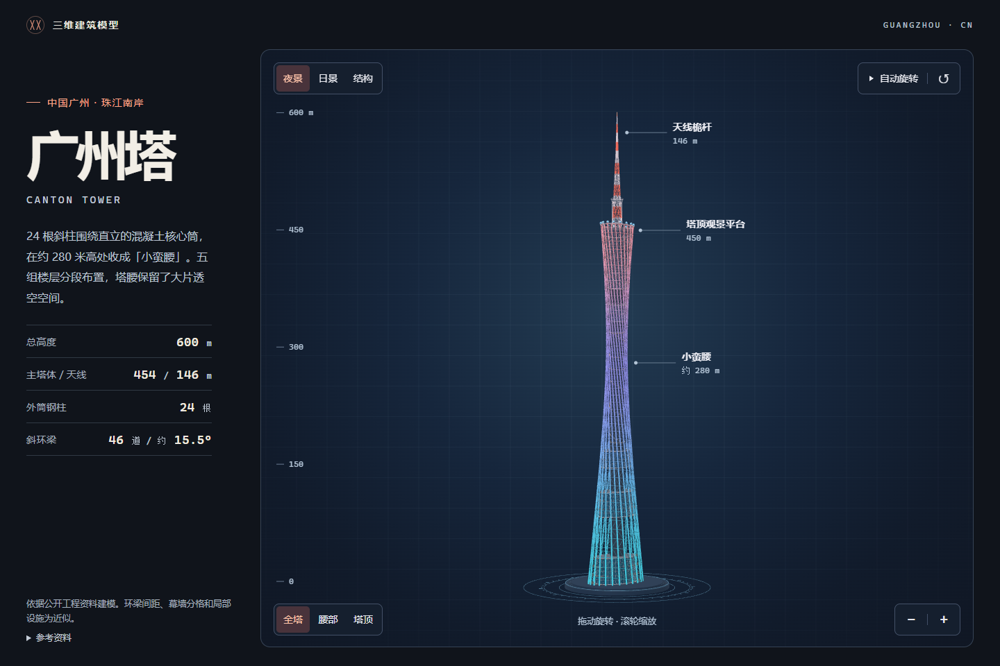
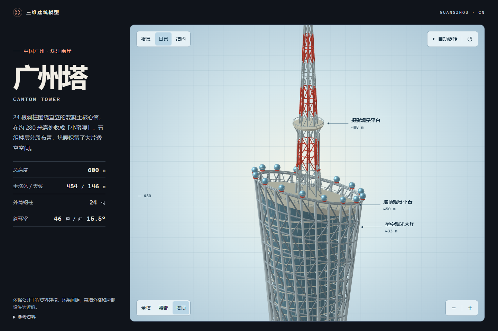

# 广州塔 3D · Canton Tower

用 HTML、JavaScript 和 WebGL 制作的交互式广州塔建筑模型。模型可离线运行，支持从全塔切换到塔腰和塔顶近景。

## 预览

## 本地打开

下载仓库中的 `index.html`，用支持 WebGL 的浏览器打开即可。模型与界面都内嵌在 HTML 中。

| 控件 | 操作 |
| --- | --- |
| 旋转 | 鼠标或单指拖动，也可聚焦画布后使用方向键 |
| 缩放 | 鼠标滚轮、双指捏合或页面上的 `+` / `−` |
| 观察位置 | 切换「全塔」「腰部」和「塔顶」 |
| 显示模式 | 切换「夜景」「日景」和「结构」；结构模式隐藏幕墙，露出核心筒与楼层连接 |
| 视角控制 | 使用「自动旋转」环绕观看，用重置按钮或 `Home` 回到起始视角 |

## 建模依据

- 主塔体高 454 米，天线桅杆高 146 米。外筒包含 24 根斜柱和 46 道倾斜环梁，约 280 米处的截面用于校准塔腰比例。[香港理工大学结构监测论文](https://ira.lib.polyu.edu.hk/bitstream/10397/24216/1/Xia_deformation_monitoring.pdf)
- 五组功能层沿核心筒分段布置，塔腰建有绕核心筒上升的空中云梯。[功能区施工资料](https://patents.google.com/patent/CN105155904A/zh) · [奥雅纳设计资料](https://www.arup.com/globalassets/downloads/insights/a/arups-innovation-legacy/arup-innovation-legacy-chinese.pdf)
- 塔顶建模包含倾斜观景平台、横向摩天轮的 16 个球舱、488 米摄影观景平台和分段式天线桅杆。[广州市文广旅局](https://wglj.gz.gov.cn/ztmb/gzhyn/ajjq/4a/content/post_8928935.html) · [摩天轮球舱资料](https://www.zc.gov.cn/gk/rdhy/content/post_3848242.html) · [桅杆构造资料](https://patentimages.storage.googleapis.com/81/b5/13/64ea7ee513e0f8/CN201924636U.pdf)

模型用于建筑外观与结构展示。环梁间距、幕墙分格和局部设施采用近似建模。上方预览为模型运行截图。
